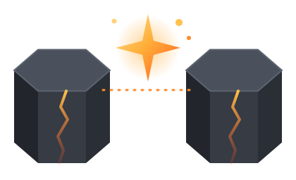

# 03 · Two Sparks: Sparkstone Twin

<p align="center"></p>

Two DGX Sparks give **256 GB of unified memory, 2 × 273 GB/s of bandwidth, and a 200 GbE ConnectX-7 link** between
them. How much of that a model can use depends on how the work is split. This page ranks the options by value and
risk, for Inkling 2 Mini first and bigger models after.

## The link, in numbers

| | Value | Source |
|---|---|---|
| Physical | ConnectX-7, 2× QSFP. Each port shows up as **two** interfaces (two PCIe Gen5 x4 halves, ~100 Gb/s each) | NVIDIA connect-two-sparks playbook |
| RDMA bandwidth | 189.9 Gb/s (`ib_write_bw`, both halves) | NVIDIA performance guide |
| NCCL all-reduce | ~22 GB/s busbw at large sizes when configured right (both HCAs, MTU 9000). Misconfigured setups get 3–15 GB/s | NVIDIA setup script threshold; forum reports |
| **Small-message latency** | **Not published.** Anecdotes range from ~10 µs to **1–1.5 ms** with default CPU power states | Measure it: `scripts/dual/check-link.sh` |
| GPUDirect RDMA | **Not supported.** The NIC cannot DMA `cudaMalloc` memory; use `cudaHostAlloc` buffers. NCCL stages through the host | DGX Spark porting guide |

`scripts/dual/setup-link.sh` applies NVIDIA's layout: both halves addressed (192.168.100.0/24 and
192.168.101.0/24), MTU 9000.

## Option 1: data parallel ✅ shipped

Each Spark runs the whole model; the router sends each conversation to one of them.

```
client ──► spark_router (:8000) ──┬──► Spark A: Basalt (:8080)   full model, own KV cache
                                  └──► Spark B: Basalt (:8080)   full model, own KV cache
```

- **Affinity:** rendezvous hashing on model + system prompt + first user turn, so a conversation keeps hitting the
  Spark that holds its prefix cache (Basalt reuses a held conversation's KV).
- **Spill:** when the home Spark already has `--spill-at` (default 2) requests in flight and the other has fewer,
  the request goes to the other one. A cache miss is cheaper than waiting in a queue.
- **Health and failover:** `/health` is polled every 2 s. A refused connection is retried once on the other Spark,
  as long as no byte has reached the client yet.
- **Gains:** ~2× aggregate throughput, 2× KV pool (two 1M-token contexts at once), and one machine can go down
  without an outage. **No gain per stream.**

The link isn't needed for this: the router can run on either Spark or a third machine over the LAN.

## Option 2: expert parallel 🔬 research, gated

Split each layer's 128 experts 64/64 between the Sparks. Each node keeps the dense weights, attention and KV
(replicated), and computes only its own experts' rows. Per layer visit there are two exchanges (dispatch the
window's activations, combine the partial outputs), each about 4.6 KB per row.

Inkling 2 Mini makes **48 layer visits per token** (its 12-layer core loops 3×), so a window crosses the link about
96 times. Time per window = memory time (now split) + 96 × hop latency.

| Hop latency | Plain decode | Conversation | Struct | vs one Spark (conv.) |
|---|---:|---:|---:|---:|
| 10 µs | 42 | 73 | 180 | **1.6×** |
| 25 µs | 40 | 71 | 174 | 1.6× |
| 100 µs | 31 | 60 | 148 | 1.3× |
| 1,000 µs | 8 | 22 | 54 | **0.5×** (slower) |

*(tok/s from [`tools/perf_model.py`](../tools/perf_model.py), ρ = 0.5. A model, not a measurement.)*

Drafting helps a lot here: an 8-row verification window pays the 96 hops once for 3–7 tokens.

**Gate:** build this only if `check-link.sh` measures ≤ 25 µs for 8 B–8 KiB RDMA writes after power-state tuning.
Community tensor-parallel results for small-active MoE models on two Sparks are only **1.17–1.56×**, which is
consistent with latency-bound exchanges.

How it would be built: Basalt already has an "expert tier" (a second card holds experts and computes their rows in
every decode window), plus host-staged exchanges priced at about 5.4 µs per 10 KiB over PCIe. The same structure
fits a network backend: one RoCE verbs queue pair per half-link over `cudaHostAlloc` buffers, with GPU-side
doorbells polled by a CPU thread. Avoid NCCL for 4.6 KB messages; its per-call overhead is the problem, and NCCL
on GB10 also wants `maxCTAs = 8`.

## Option 3: prefill/decode split 🔬 research

Spark A reads long prompts (Basalt: ~12–14K tok/s on a 5090; perhaps 2–3K on GB10); Spark B decodes. The KV cache
moves once per request: with `--kv fp8`, Inkling's 8 full-attention visits cost ~16 KiB per position, plus the
window layers' fixed rings. A 128K-token prompt is ~2 GB, about 0.1 s at 20 GB/s, against tens of seconds of
prefill. Worth doing for agents that re-read large repositories or documents while another user is decoding.

## Option 4: models too big for one Spark 🗺️ roadmap

| Basalt pack | Size | One Spark (~119 GiB usable) | Two Sparks |
|---|---:|---|---|
| Inkling 2 Mini NVFP4-q8 | 19.7 GB | ✅ | (data parallel) |
| Qwen3.8-Flash-Next UD-IQ1_S | 70.4 GB | fits, but needs NEON CPU kernels first | — |
| Hy4-flash NVFP4 | 158.7 GB | ❌ | ✅ fits (~80 GB each) |
| DeepSeek-V4.1-Flash UD-IQ1_M | ~260 GB | ❌ | ❌ (just over 256 GB) |

For Hy4-flash, Basalt's **layer split** (each card runs a block of layers, and the window is handed over once per
cut) is the natural fit across a network. It needs 1–2 hops per window rather than 96, so latency hardly matters.
That makes it the most robust multi-node mode, and it unlocks a 159 GB model on desktop hardware.

## What to run first

1. `scripts/dual/setup-link.sh` on both Sparks.
2. `scripts/dual/check-link.sh` (server on B, client on A). Keep the report.
3. `scripts/dual/start-dual.sh`: data parallel, usable from day one.
4. If the latency is ≤ 25 µs, start option 2 on a branch. If not, go to option 4.
